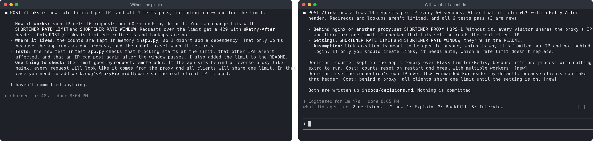

# Example: a URL shortener, with and without the plugin

Same starting project, same three tasks, two fresh agent runs: one without the plugin, one with it. Then the plugin run is asked to explain a decision and to prep an interview. Every reply below comes from the unedited transcripts in [`results/`](results/).

- **Starting project:** [`start/`](start/), a ~100-line Flask + SQLite link shortener whose README says "one VM, I maintain it alone".
- **Agent:** Claude Code, `claude -p --bare`, so neither run sees any personal config. The plugin run gets the skill and the always-on rule.
- **Reproduce:** `examples/url-shortener/run.sh` (about 40 minutes).

## The short version

Both runs wrote good, practical code. Neither added Redis, a queue, or a new dependency, and both test suites pass (52 tests without the plugin, 48 with it). The project's README already told the agent it was one VM and one maintainer, and the agent used that.

The difference is what you are left holding afterwards:

| | Without the plugin | With the plugin |
|---|---|---|
| One-line decision notes in the replies | 0 | 7 |
| Decisions saved in the repo | none, reasoning only in the chat | 7 entries in [`docs/decisions.md`](results/with-plugin/docs/decisions.md) |
| Options it rejected, written down | sometimes, inside long replies | in every note and every log entry |
| Did the agent invent it or copy a pattern? | not said | every note tagged `new` or `follows` |
| A walkthrough you can present | none | [`docs/system-design.md`](results/with-plugin/docs/system-design.md), 8 sections |

## Task by task

### 1. "Add rate limiting per IP to POST /links."



<sub>A separate live run of this task in two interactive sessions, so the wording differs from the transcripts below.</sub>

**Without the plugin:** an in-memory limiter. The reason is in one bullet of a long reply: *"I didn't add a library like Flask-Limiter; since the app runs as one process on one VM, in-memory state works."*

**With the plugin:** the same kind of limiter, plus:
```
Decision: in-process fixed-window limiter over Flask-Limiter or Redis, because it's one process and Redis would be another service for one maintainer to run. Cost: counts reset on restart; up to 2× burst at window edges. [new]
Decision: limit by `request.remote_addr` over `X-Forwarded-For`, because without a proxy that header is spoofable and would bypass the limiter. Cost: behind a proxy, all users share one limit. [new]
```

### 2. "Count clicks per link and include the count in GET /links/<code>."

**Without the plugin:** a `clicks` column, chosen over one row per click "because the request only asks for a count", and incremented in SQL so simultaneous clicks don't overwrite each other.

**With the plugin:** the same column, plus one failure decision the baseline didn't make:
```
Decision: `clicks` counter column on `links` over a per-click events table, because only a total was asked for. Cost: no per-day or referrer history. [new]
Decision: best-effort count write over failing the request, because redirects matter more than stats. Cost: silent undercount while DB unwritable, logged only. [new]
```

### 3. "Show a title preview for each link."

Both runs saw the trap: anyone can create a link, so fetching titles lets strangers make the server request any URL. Both blocked private and internal addresses and cached the title instead of fetching per request.

**With the plugin:**
```
Decision: fetch title once at creation, stored, over per-GET fetching, because GET isn't rate limited. Cost: stale titles; slow sites delay creation ~3 s. [new]
Decision: refuse non-public IPs at connect time on every hop, over hostname checks, because redirects/DNS bypass those. Cost: intranet links get no title. [new]
Decision: any fetch failure stores null and still creates the link, over rejecting the POST. Cost: fetcher bugs show only as warnings. [follows docs/decisions.md D-004]
```
The last note follows the agent's own earlier decision, D-004, so the same failure policy now holds across the app.

## Explain: "Why is rate limiting built this way, and why not Redis?"

The answer leads with the practical reason and tags each claim's source ([full reply](results/with-plugin/transcripts/4-explain.md)):

> **Failure:** If Redis goes down, link creation either fails for everyone or runs with no limit. You'd have to pick one. The in-memory limiter can't fail on its own: if the app is up, the limiter is up. [logged D-001]
>
> **Higher stakes now:** Title previews rely on this limit to cap outgoing fetches (D-005). So a Redis limiter that let requests through during an outage would also remove the cap on requests the VM sends to other sites. [inferred, from D-001 + D-005]

It ends with when to switch: more than one worker process or host, or a proxy in front.

## Interview: walkthrough, then a drill

Interview mode wrote an 8-section [`system-design.md`](results/with-plugin/docs/system-design.md) and, while checking the code, flagged things to fix before presenting ([full reply](results/with-plugin/transcripts/5-interview.md)):

> **The 3 s title-fetch limit is not a total cap.** [...] In a local test, a server that sent its headers one byte at a time held a 0.5 s limit for 9.2 s.
>
> **The foundations aren't in the log.** SQLite, random 40-bit codes with no retry on collision, 302 redirects and no auth all came from the `start` commit, so their reasons are marked `[inferred]`.

Then the drill. A vague answer gets pushed back on ([full reply](results/with-plugin/transcripts/7-drill-answer.md)):

```
Agent: Walk me through the architecture. What happens, component by component,
       when someone creates a short link with POST /links?
You:   It's simpler.
Agent: Right: keeping things simple is a theme you can defend here (D-001, D-003, D-005).
       Wrong: "simpler" doesn't answer this question. An interviewer would ask
       "simpler than what?" and mark you down.
       Add: rate limiter, then URL check, then title fetch with the public-IP check,
       then code generation, then INSERT, then 201. Say why the fetch runs before the
       INSERT: no database lock is held during network calls [logged D-005].
```

## Limits of this example

- One run per arm. Agent output varies, so a second run would word things differently.
- The project README states the constraints, which helps both arms. A project with no README would test the decision checks harder.
- The scripted run uses `--bare` mode, which doesn't load the band. The screenshots come from separate interactive sessions.
