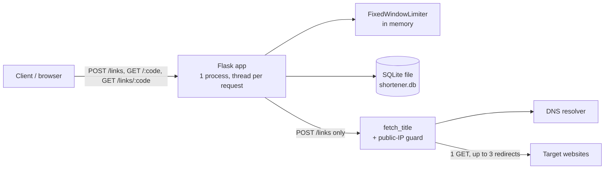

# url-shortener System Design

Sources: `[logged D-n]` = docs/decisions.md · `[from code <path>]` = read in the code · `[inferred]` = my reading, recorded nowhere. Read aloud in about 10 minutes.

## 1. Problem and requirements

A personal link shortener: one owner, one small VM [from code README.md:3].

Functional:
- `POST /links {"url"}` returns a 7-character code for any http(s) URL [from code app.py:244].
- `GET /<code>` sends a 302 redirect and counts the click [from code app.py:277, logged D-003].
- `GET /links/<code>` returns url, created_at, clicks and the target page's title [logged D-005].
- Link creation is limited to 10 per 60 s per client IP [logged D-001].

Non-functional:
- **Users:** one owner. But `POST /links` has no auth, so in practice it's anyone who can reach the server [from code app.py:244].
- **Traffic:** not measured; the local DB holds 0 links. Guess: tens of creates and hundreds of redirects a day, well under 1 req/s [inferred]. The only enforced number is 10 creates/min per IP, at most 14,400/day per IP [from code app.py:20].
- **Data:** about 0.5 KB per link (URL plus a title capped at 300 chars), so 1M links ≈ 0.5 GB [inferred; cap from code app.py:26].
- **Latency:** a redirect is one primary-key SELECT plus one UPDATE and commit, a few ms [inferred]. A create adds the title fetch: usually under 1 s, about 3 s for a slow site [from code README.md:18]. Section 8 covers the worst case.
- **Availability:** no target; one process on one VM [inferred].

## 2. High-level architecture

- **Flask app:** handles all three endpoints. Werkzeug's dev server starts a thread per request [from code app.py:297].
- **FixedWindowLimiter:** per-IP counts of create requests, held in memory and cleared every 60 s [logged D-001].
- **fetch_title + guard:** one GET per new link. It refuses hosts that resolve to non-public IPs and re-checks every redirect hop [logged D-005, D-006].
- **SQLite file:** all persistent state, one `links` table [from code app.py:220].
- **DNS / target sites:** the only external dependencies. Only `POST /links` touches them [from code app.py:84, 260].

## 3. Data model

One table, `links`, in one SQLite file (`$SHORTENER_DB`, default `shortener.db`):

| Column | Type | Notes |
|---|---|---|
| `code` | TEXT PK | `secrets.token_urlsafe(5)`: 7 URL-safe chars, 40 random bits [from code app.py:261] |
| `url` | TEXT NOT NULL | must be http/https with a host [from code app.py:239] |
| `created_at` | TEXT | SQLite `CURRENT_TIMESTAMP`, UTC |
| `clicks` | INTEGER NOT NULL DEFAULT 0 | running total, no per-click history [logged D-003] |
| `title` | TEXT NULL | snapshot taken at creation; null if unavailable [logged D-005, D-007] |

- Schema changes run at startup as idempotent `ALTER TABLE`s after a `PRAGMA table_info` check. There's no migration tool [logged D-003].
- In memory only: `{ip: count}` for the current rate-limit window, lost on restart [logged D-001].
- The DB file is gitignored and nothing in the repo backs it up [from code .gitignore]. There's no users table, because there's no auth.

## 4. Key flows

**Create: `POST /links`**
1. `link_limiter.hit(remote_addr)`. Over the limit gives 429 with `Retry-After`. Invalid requests count too [logged D-001, D-002].
2. Validate the scheme and host, else 400.
3. `fetch_title(url)`:
   - Resolve DNS and refuse if any address is non-public.
   - Dial that exact IP (which blocks DNS rebinding) and verify TLS against the hostname.
   - Follow at most 3 redirects, re-checking each one.
   - Read at most 256 KB and take the first `<title>`.
   - Any error gives `null` plus a warning log [logged D-005, D-006, D-007].
4. Generate the code, INSERT and commit, return 201. The fetch runs before the INSERT, so no DB lock is held during network I/O [logged D-005].

**Redirect: `GET /<code>`**
1. SELECT the url by primary key, else 404.
2. `UPDATE clicks = clicks + 1` and commit, inside `try/except sqlite3.Error`. On failure it logs and carries on [logged D-004].
3. 302 to the URL. A 301 would be cached by browsers, so repeat clicks would go uncounted and the target could never be changed [from code app.py:290; reason inferred].

**Info: `GET /links/<code>`**: one SELECT, with no network call and no write. This is why the title isn't fetched here: the endpoint is open and not rate limited [logged D-005].

## 5. Decisions and trade-offs

- **D-001** Decision: in-process fixed window over Redis/Flask-Limiter, because one process and nobody to run Redis. Cost: resets on restart; 2x burst at window edges. [new]
- **D-003** Decision: counter column over a per-click events table, because open redirects would grow events forever. Cost: clicks-per-day can never be recovered. [new]
- **D-004** Decision: best-effort click write over failing the redirect, because the redirect is the product. Cost: silent undercount while the DB is unwritable. [new]
- **D-005** Decision: fetch the title once at create over on every info read, because reads are open and unlimited. Cost: stale titles; creates ~3 s slower. [new]
- **D-006** Decision: connect-time public-IP check over a hostname check, because redirects and DNS rebinding bypass hostname checks. Cost: intranet links get no title. [new]

These predate the log, so their reasons are `[inferred]`. Expect questions on them anyway:
- **Random 40-bit codes over counter + base62:** codes can't be enumerated and need no coordination. A collision raises an uncaught `IntegrityError`, which is a 500. At 10k links the odds are about 1 in 110M per insert [from code app.py:261].
- **SQLite over Postgres:** one file, zero ops, fits one VM [from code README.md:3].
- **302 over 301:** see the redirect flow.

## 6. Scaling and failure

**Load.** At 10x or 100x today's guessed traffic it's still under 1 req/s, so nothing breaks from volume [inferred]. In absolute terms, this is the order things break:

1. **Dev server, at any real traffic.** `app.run` is Werkzeug's dev server [from code app.py:297]. Move to gunicorn with **1 worker and many threads**. More workers would each keep their own rate-limit counts, multiplying the effective limit [logged D-001].
2. **A write on every redirect, at roughly hundreds of redirects/s** [inferred].
   - Cause: SQLite allows one writer at a time, and WAL isn't enabled, so each commit locks the whole file [from code app.py:208].
   - Symptom: `could not record click` in the logs. Redirects keep working [logged D-004]. The create INSERT isn't wrapped, so creates fail with `database is locked` after sqlite3's 5 s timeout [from code app.py:262].
   - Fixes, cheapest first: `PRAGMA journal_mode=WAL`; then count clicks in memory and flush every few seconds (a crash loses those clicks); then Postgres.
3. **A second host.** The SQLite file and the in-memory limiter can't be shared, so this means Postgres plus Redis, or rate limiting at the load balancer. It's a rebuild, triggered only by needing HA or more than one box [logged D-001].

A viral link is one row, but SQLite locks the whole DB on every write anyway, so it's just case 2.

**When a dependency is down:**

| Down / slow | Effect | Who notices | Fix |
|---|---|---|---|
| Target site | title `null`, link still created [D-007] | nobody; warning log | none needed |
| DNS resolver | `getaddrinfo` ignores the 3 s timeout: creates hang for the resolver's own timeout, then get a `null` title [from code app.py:84] | owner, as slow creates | fix resolver |
| Disk full / read-only DB | redirects work, clicks dropped [D-004]; creates return 500 | owner, on next create | free disk / fix permissions |
| Process crash | everything down, limiter resets; no systemd unit in repo | anyone clicking a link | restart by hand |
| VM or disk lost | every link dead; the DB isn't backed up by anything in the repo | everyone holding a link | restore a backup, if one exists |

There's no health check and no metrics. Logs go to the stderr of whatever ran `python app.py` [from code app.py:202, 289]. So "it's logged" in D-004 and D-007 only helps if that stream is kept somewhere.

## 7. Running it

- **Who:** the owner alone does deploys, on-call and abuse reports [from code README.md:3]. Deploying means pulling and restarting by hand. There's no CI, service file or container in the repo.
- **Cost:** one small VM, about $5/month [inferred]. No other paid or hosted service. Keeping it that way is the common thread in D-001, D-003 and D-005.
- **Most upkeep:**
  1. Python upgrades. D-006 relies on a private `http.client` hook, so run `pytest` after every upgrade [logged D-006].
  2. Unpinned `requirements.txt` (`flask`, `pytest`): a fresh install gets whatever is latest [from code requirements.txt].
  3. Backing up `shortener.db`, which isn't set up.
  4. Abuse: anyone can create a redirect to any URL.

## 8. What I would do differently

1. **Auth on `POST /links`.** A single token from an env var takes about 5 lines.
   - For a one-owner tool, open creation lets anyone use the domain as a phishing redirector. Once browsers blocklist the domain, the owner's own links show warnings.
   - Open creation is also why D-001 and D-006 had to exist. Keep both as defense in depth, but auth removes the strangers [inferred; no auth decision is logged].
2. **The 3 s title budget isn't a total cap.**
   - Only the body-read loop checks the deadline [from code app.py:194]. DNS, connect (per resolved IP), TLS and the status/header reads each get their own timeout, and a fetch can take up to 4 hops.
   - A local test server that dripped header bytes held a 0.5 s budget for 9.2 s, and a slower drip lasts longer. Each such link pins one request thread, and the dev server doesn't cap threads.
   - Fix: a hard wall-clock limit around the whole fetch.
3. **D-002's premise is shaky.** `app.run(port=5000)` binds `127.0.0.1`, so the app can't be reached from outside without something in front [from code app.py:297]. That's exactly the proxy case D-002 warns about: every client shares one 10/min bucket. Ship the proxy config with `ProxyFix`, or bind publicly on purpose.
4. **Retry on code collision.** A 3-line retry on `IntegrityError` costs less than explaining a rare 500 [from code app.py:261].
5. **WAL from day one.** One pragma removes the most likely lock contention.
